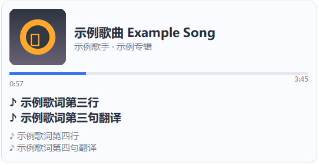

# AIMP Now Playing → OBS

[](LICENSE)
[]()
[]()

实时读取 AIMP 正在播放的歌曲信息，提供**桌面悬浮窗**与 **OBS 浏览器源**两种展示方式：封面、歌名、进度、实时歌词，支持多主题与深度自定义。

## 功能特性

- 🎵 实时获取 AIMP 播放状态、曲目信息、封面与进度（使用官方 Remote API，无需插件）
- 🖥 桌面悬浮窗：无边框置顶、半透明、等比缩放、跨显示器拖动、全局快捷键锁定
- 📺 OBS 浏览器源：8 套主题、九宫格定位、自定义颜色/字体/控件显隐，改样式实时同步
- 📝 歌词：同步 LRC 逐行高亮，中日翻译双行显示，平滑滚动切换，支持本机字体搜索选择
- 💾 设置自动保存，重启不丢失
- 🎭 演示模式：一键让 GUI、悬浮窗与 OBS 覆盖页全部显示示例数据
- 📦 单文件 exe 发布，无需安装 Python

## 截图





## 快速开始

### 直接使用 exe

从 Releases 下载 `AIMPNowPlaying.exe`，双击运行即可。首次启动需要几秒解压内置运行时。

### 从源码运行

仅支持 Windows，需要 Python 3.10+。

```powershell
python -m pip install -r requirements.txt
python main.py
```

只运行后台服务（无 GUI）：

```powershell
python main.py --headless
```

## OBS 集成

1. OBS 中添加“浏览器（Browser）”源
2. URL 填 `http://127.0.0.1:8765/`
3. 宽度建议 `460`，高度 `240`，按需调整

浏览器打开 `http://127.0.0.1:8765/preview` 可并排预览全部主题（模拟数据）。

### 主题

| 主题 | 说明 |
| --- | --- |
| `modern` | 默认深色卡片 |
| `glass` | 毛玻璃 + 青紫渐变 |
| `minimal` | 透明无边框极简 |
| `neon` | 霓虹发光 |
| `spotify` | Spotify 风格 |
| `light` | 白色卡片 |
| `bar` | 横向紧凑条（16:9 底部） |
| `center` | 竖屏居中（9:16） |

### 常用参数

```text
http://127.0.0.1:8765/?theme=neon&pos=bottom-right&width=460
```

| 参数 | 作用 |
| --- | --- |
| `theme` | 选择主题 |
| `pos` | 九宫格定位：`bottom-left` / `center` / `top-right` 等 |
| `coverside` | 封面位置：`left` / `right` / `top` |
| `bg` / `panel` | 页面/面板背景色 |
| `accent` / `accent2` | 强调色与进度条渐变终点 |
| `text` / `dim` | 主文字 / 次要文字颜色 |
| `width` / `fontsize` / `margin` | 宽度、字号、边距 |
| `lyricfont` | 歌词字体（本机字体名） |
| `cover` / `title` / `state` / `progress` / `lyrics` | 隐藏对应控件（`off`） |
| `hide` | 停止播放时隐藏面板（`stopped`） |
| `demo` | 模拟数据预览（`1`） |

## 桌面悬浮窗

主界面点击“🖥 桌面悬浮窗”打开。

- 拖动：按住窗口任意位置拖动，支持跨显示器
- 缩放：`Ctrl + 鼠标滚轮` 等比缩放（40% ~ 250%）
- 锁定/解锁拖动：全局快捷键 `Ctrl + Shift + L`，切换时右下角短暂显示 🔒/🔓
- 右键菜单：播放控制（播放/暂停、上一首、下一首、停止）、外观（主题/透明度/缩放/歌词字号动画）、交互（锁定）、关闭

## 配置

### 命令行参数

```text
--host 127.0.0.1     服务监听地址
--port 8765          服务端口
--refresh 300        状态刷新间隔（毫秒）
--export 目录        导出文件目录
--headless           无 GUI 模式
--version            显示版本号
```

### 设置保存

所有设置自动保存到 `%APPDATA%\AIMP-OBS-NowPlaying\settings.json`，命令行参数优先于已保存设置；可用环境变量 `AIMP_SETTINGS_PATH` 指定自定义位置。

### 导出文件

运行时会更新 `export/` 目录（默认在程序所在目录）：

- `nowplaying.json` — 完整 JSON 状态
- `nowplaying.txt` — 简单文本（标题/歌手/时间）
- `cover.png` — 当前封面
- `lyrics.lrc` — 当前歌词

## 从源码构建与测试

```powershell
python -m pip install -r requirements-dev.txt
python -m pytest
.\build_exe.ps1
```

GitHub Actions 会在 Windows 上自动执行测试并构建 exe。

## 技术栈

- Python 3.10+，`ctypes` 直接调用 Win32 API
- AIMP Remote API（窗口消息 + 共享内存 + `WM_COPYDATA` 封面）
- CustomTkinter（主界面）、Tkinter Canvas（悬浮窗）
- Pillow（图片处理）、mutagen（音频标签/内嵌封面歌词）
- PyInstaller（单文件打包）

## 项目结构

```text
AIMP-OBS-NowPlaying/
├── main.py                 入口（GUI / --headless）
├── aimp_obs/
│   ├── aimp_api.py         AIMP Remote API 封装
│   ├── lyrics.py           LRC/内嵌歌词解析
│   ├── cover.py            封面提取与缓存
│   ├── state.py            状态汇总与导出
│   ├── overlay.py          OBS 覆盖页（HTML/CSS/JS）
│   ├── server.py           本地 HTTP 服务
│   ├── gui.py              CustomTkinter 主界面
│   ├── floating.py         桌面悬浮窗
│   ├── settings.py         设置持久化
│   └── paths.py            源码/exe 路径工具
├── tests/                  单元测试
├── assets/                 应用图标
├── .github/workflows/      CI 构建
└── LICENSE
```

## 常见问题

**提示“未检测到 AIMP”**：请先启动 AIMP；AIMP 重启后程序会自动重连。

**歌词不显示**：确认歌曲同目录存在同名 `.lrc`（例如 `歌手 - 歌名.lrc`），或音频内嵌歌词。

**端口被占用**：在设置中更换端口，或使用 `--port` 指定。

**封面不显示**：优先使用 AIMP 返回的封面，其次读取音频标签/同目录 `cover.jpg`、`folder.jpg`。

## 隐私

- 所有数据仅在本机处理，不会上传歌曲、歌词或封面
- 服务默认只监听 `127.0.0.1`；使用 `--host 0.0.0.0` 暴露到局域网时，同一网络内任何设备都能读取状态并修改覆盖页配置

## 贡献

欢迎提交 Issue 和 Pull Request：

- 报告问题前请提供 AIMP 版本、Python 版本、复现步骤
- 代码风格跟随现有项目，提交前请运行 `python -m pytest`
- 重大变更请先开 Issue 讨论

## 许可证

本项目采用 **GPL-3.0-or-later**（见 [LICENSE](LICENSE)）。

主要依赖许可证：

- mutagen：GPL-2.0-or-later
- Pillow：HPND
- CustomTkinter：MIT
- PyInstaller：GPL-2.0-or-later（含分发例外）

> `assets/icon.ico` 为项目作者提供的 logo，不属于 GPL 许可证覆盖范围，未经许可请勿在其他项目或分发物中复用。

## 致谢

- [AIMP](https://www.aimp.ru/) 及其官方 Remote API / SDK
- [CustomTkinter](https://github.com/TomSchimansky/CustomTkinter)
- [Pillow](https://python-pillow.org/)
- [mutagen](https://mutagen.readthedocs.io/)
- [PyInstaller](https://pyinstaller.org/)
