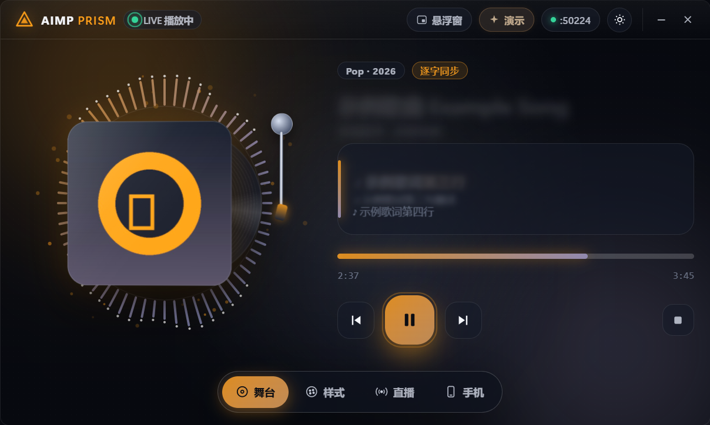
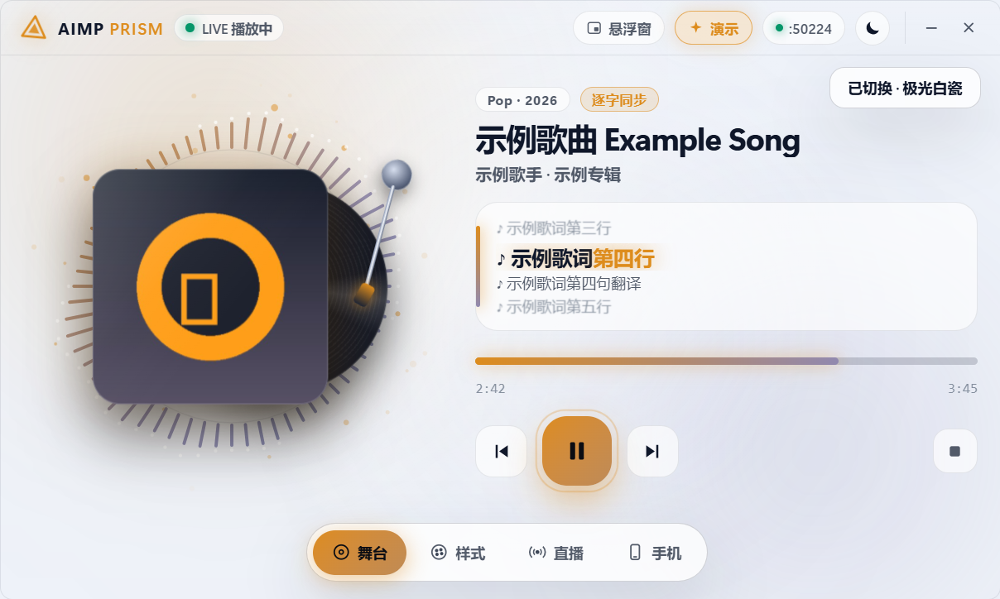
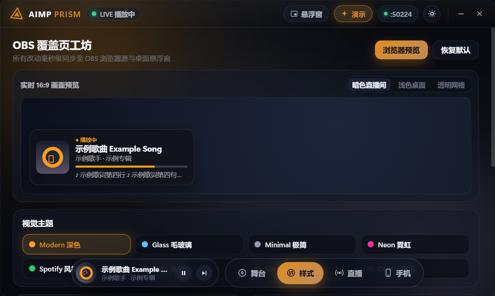
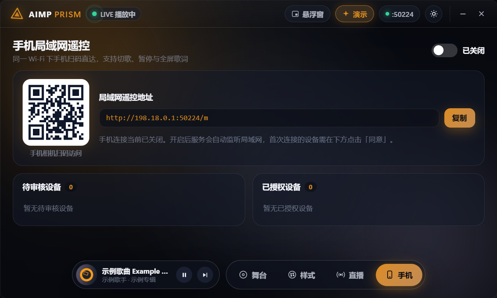
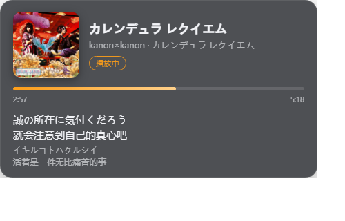

# AIMP Prism

[](LICENSE)
[]()
[]()
[]()

> 原 `aimp-obs-now-playing` 全面进化版 —— 基于 **pywebview (Edge WebView2 GPU 加速)** 与 **Win32 原生能力**打造的全息黑胶音频控制台、透明置顶桌面悬浮歌词、OBS 浏览器源与局域网手机遥控套件。

实时读取 AIMP 正在播放的歌曲信息，提供**全息黑胶控制台**、**桌面悬浮窗**、**OBS 浏览器源**与**局域网手机遥控**四种联动体验：封面、歌名、进度、逐字/双语歌词，支持深度视觉自定义。

## ✨ v2.0 核心特性

- 💿 **全息黑胶舞台（Holographic Vinyl Deck）**：
  - 无边框 Windows 11 原生圆角玻璃窗口 + 全画幅动态封面极光背景（实时提取专辑封面三色驱动氛围光球与鼠标聚光灯）
  - 3D 交互式专辑封套（鼠标悬停 3D 视差倾斜 + 全息扫光）、播放自动滑出的旋转黑胶碟片与联动金属唱臂
  - Canvas GPU 60/120FPS 64 频段双色流光环形频谱 + 飘散星尘粒子
  - 磁吸跟随播放控制键 + 点击粒子爆发反馈 + 液态流光进度条（支持拖拽/点击精准 Seek 跳转 AIMP 播放位置）
- 🌗 **GPU 圆形光波切主题**：点击右上角光球（或按 `T`）通过原生 View Transitions API 径向光波扩散切换 **暗夜黑胶 / 极光白瓷**，同步 DWM 窗口边框色
- 🏝 **底部悬浮灵动岛 Dock**：弹簧高亮滑块丝滑切换「舞台 / 样式 / 直播 / 手机」四大工作区，切离舞台时自动滑出迷你旋转黑胶播放胶囊
- 🖥 **零 Tk 桌面悬浮窗**：
  - 同样由 `pywebview` 独立窗口驱动（全运行态零 `tkinter`/`tcl86t.dll`），经典三段式排版（封面+歌名 / 进度条+时间 / 双行原词+翻译歌词）
  - Win11 原生 DWM 圆角 + 系统级 `WS_EX_LAYERED` 真桌面透视半透明（50%–100% 实时可调）
  - 原生 Win32 桌面右键级联菜单（缩小窗口也永不裁切）、`Ctrl + 滚轮` 非线性保底缩放、`Ctrl + Shift + L` 全局锁定拖动，**不占用任务栏图标**
- 📺 **OBS 样式工坊**：1:1 实时 16:9 画面预览（暗色直播间 / 浅色桌面 / 透明网格三背景）、8 套主题、九宫格定位、本机字体即时搜索与真机预览、改动毫秒级同步 OBS
- 📱 **手机局域网遥控**：内置零依赖纯前端 SVG 实时二维码，手机扫码直达 `/m`，支持设备审批与红点角标提示
- 🔔 **极低占用托盘休眠**：最小化收进右下角托盘后自动暂停前端动画与轮询，后台占用趋近于零，悬浮窗与 OBS 服务继续不间断运行
- 📦 **单文件 exe 发布**：无需安装 Python，双击即用

## 📸 界面预览












## ⌨️ 快捷键

| 快捷键 | 功能 |
| --- | --- |
| `Space` | 播放 / 暂停 |
| `1` / `2` / `3` / `4` | 切换 舞台 / 样式 / 直播 / 手机 |
| `D` | 开关演示模式 |
| `F` | 开关桌面悬浮窗 |
| `T` | 圆形光波切换暗色 / 亮色主题 |
| `Ctrl + Shift + L` | 全局锁定 / 解锁桌面悬浮窗拖动 |
| `Ctrl + 滚轮` | 悬浮窗内等比缩放（55% – 220%） |

## 🚀 快速开始

### 直接使用 exe

从 [Releases](https://github.com/cirtuslab/aimp-prism/releases) 下载 `AIMPNowPlaying.exe`，双击运行即可（Windows 10/11 已内置 Edge WebView2 运行时）。

### 从源码运行

仅支持 Windows，需要 Python 3.10+。

```powershell
python -m pip install -r requirements.txt
python main.py
```

只运行后台服务（无 GUI）：

```powershell
python main.py --headless
```

## 📺 OBS 集成

1. OBS 中添加“浏览器（Browser）”源
2. URL 填 `http://127.0.0.1:8765/`
3. 宽度建议 `460`，高度 `240`，按需调整

浏览器打开 `http://127.0.0.1:8765/preview` 可并排预览全部 8 套主题。

### 主题

| 主题 | 说明 |
| --- | --- |
| `modern` | 默认深色卡片 |
| `glass` | 毛玻璃 + 青紫渐变 |
| `minimal` | 透明无边框极简 |
| `neon` | 霓虹发光 |
| `spotify` | Spotify 风格 |
| `light` | 白色卡片 |
| `bar` | 横向紧凑条（16:9 底部） |
| `center` | 竖屏居中（9:16） |

### 常用 URL 参数

```text
http://127.0.0.1:8765/?theme=neon&pos=bottom-right&width=460
```

| 参数 | 作用 |
| --- | --- |
| `theme` | 选择主题 |
| `pos` | 九宫格定位：`bottom-left` / `center` / `top-right` 等 |
| `coverside` | 封面位置：`left` / `right` / `top` |
| `bg` / `panel` | 页面/面板背景色 |
| `accent` / `accent2` | 强调色与进度条渐变终点 |
| `text` / `dim` | 主文字 / 次要文字颜色 |
| `width` / `fontsize` / `margin` | 宽度、字号、边距 |
| `lyricfont` | 歌词字体（本机字体名） |
| `cover` / `title` / `state` / `progress` / `lyrics` | 隐藏对应控件（`off`） |
| `hide` | 停止播放时隐藏面板（`stopped`） |
| `demo` | 模拟数据预览（`1`） |

## 📱 手机局域网遥控

在底部 Dock 切换到「手机」页开启局域网连接后，直接用手机相机扫描屏幕上的实时二维码，或打开：

```text
http://电脑IP:8765/m
```

- 支持竖屏/横屏自适应、Enhanced LRC 逐字高亮、播放控制与 7 套移动端主题
- iOS Safari 可通过「分享 → 添加到主屏幕」独立全屏使用（内置 PWA manifest 与图标）
- **设备认证（默认关闭）**：新手机首次访问会出现在「待审核设备」（Dock 亮起红点角标），需在电脑端点击「同意」才下发授权 token；`/api/config` 写入始终仅限本机

## 🖥 桌面悬浮窗

点击顶栏「悬浮窗」（或按 `F`）打开，采用独立 `pywebview` 透明置顶窗口 + Win32 `WS_EX_TOOLWINDOW`（不占任务栏图标）+ `WS_EX_LAYERED`（真桌面透视半透明）：

- **拖动**：按住窗口任意位置自由拖动，支持跨显示器
- **缩放**：`Ctrl + 鼠标滚轮` 缩放（55% ~ 220%），小尺寸自动启用字号保底避免文字过小
- **锁定**：全局快捷键 `Ctrl + Shift + L` 锁定/解锁拖动
- **原生右键菜单**：播控、8 款主题、透明度（50%–100%）、缩放、歌词字号动画、锁定与关闭，独立浮于桌面永不裁切

## 🔔 最小化到托盘

点击右上角最小化按钮，主窗口隐藏至右下角系统托盘并暂停前端渲染以节省资源：

- 单击或双击托盘图标：瞬时恢复主窗口
- 右键托盘图标：显示主窗口 / 退出
- 托盘常驻期间，OBS 浏览器源、手机遥控、桌面悬浮窗与文件导出全部照常运行

## ⚙️ 配置与导出

### 命令行参数

```text
--host 127.0.0.1     服务监听地址
--port 8765          服务端口
--refresh 300        状态刷新间隔（毫秒）
--export 目录        导出文件目录
--headless           无 GUI 模式
--version            显示版本号
```

### 设置保存与导出文件

- 设置自动保存到 `%APPDATA%\AIMP-OBS-NowPlaying\settings.json`（可用 `AIMP_SETTINGS_PATH` 覆盖）
- 运行时实时导出至 `export/`：`nowplaying.json`、`nowplaying.txt`、`cover.png`、`lyrics.lrc`

## 🛠 从源码构建与测试

```powershell
python -m pip install -r requirements-dev.txt
python -m pytest
.\build_exe.ps1
```

GitHub Actions 会在 Windows 上自动执行全部单元测试并打包单文件 exe。

## 🧱 技术栈与项目结构

- Python 3.10+，`ctypes` 直接调用 Win32 / DWM / GDI API
- [pywebview](https://github.com/r0x0r/pywebview)（Windows Edge WebView2 GPU 硬件加速）
- AIMP Remote API（窗口消息 + 共享内存 + `WM_COPYDATA` 封面）
- Pillow（封面处理与主色调提取）、tinytag（音频标签/内嵌封面歌词）
- PyInstaller（单文件 exe 打包）

```text
aimp-prism/
├── main.py                     入口（GUI / --headless）
├── aimp_obs/
│   ├── aimp_api.py             AIMP Remote API 封装
│   ├── lyrics.py               LRC / Enhanced LRC / 内嵌歌词解析
│   ├── cover.py                封面提取与缓存
│   ├── state.py                状态汇总与导出
│   ├── overlay.py              OBS 覆盖页（HTML/CSS/JS）
│   ├── mobile.py               手机端页面与 PWA 清单
│   ├── devices.py              局域网设备审批与 token 管理
│   ├── server.py               本地 HTTP 服务
│   ├── theme.py                主题色板、封面取色、DWM 圆角与 Win32 GDI 字体枚举
│   ├── gui.py                  pywebview 主界面与 JS Bridge API
│   ├── floating_host.py        pywebview 桌面悬浮窗宿主（原生右键菜单/热键/透明）
│   ├── webui/                  AIMP Prism Deck 自包含前端（index/style/app/floating）
│   ├── tray.py                 系统托盘图标（Win32 Shell_NotifyIconW）
│   ├── demo.py                 演示模式模拟数据
│   ├── settings.py             设置持久化
│   └── paths.py                源码 / exe 路径工具
├── tests/                      单元测试
├── assets/                     应用图标
├── .github/workflows/          CI 构建
└── LICENSE
```

## 📄 许可证

本项目采用 **MIT**（见 [LICENSE](LICENSE)）。

主要依赖许可证：

- pywebview：BSD-3-Clause
- tinytag：MIT
- Pillow：HPND
- PyInstaller：GPL-2.0-or-later（含分发例外）
