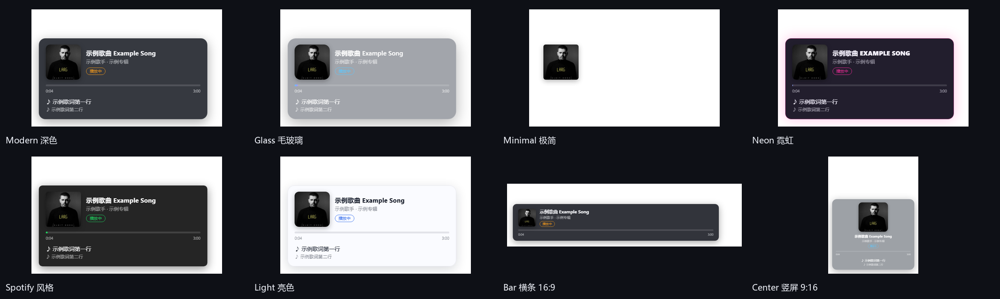

# AIMP Now Playing → OBS

一个带 GUI 的小工具：实时读取本机 AIMP 正在播放的歌曲信息，在桌面窗口里显示，并通过本地 HTTP 服务把画面直接喂给 OBS 的“浏览器源”。显示内容包括：

- 专辑封面（AIMP 返回的 PNG，或从音频文件/同目录封面提取）
- 歌曲名称、歌手、专辑、年份、流派
- 实时播放进度（进度条 + 当前时间 / 总时长）
- 实时歌词（同步 LRC 逐行高亮；无时间轴的歌词显示全文）
- 歌词平滑滚动切换（上一句滑出、下一句滑入，OBS 浏览器源生效）

## 许可证

本项目采用 **GPL-3.0-or-later**（见 [LICENSE](LICENSE)）。

选择 GPL 的原因：音频标签读取依赖 [mutagen](https://mutagen.readthedocs.io/)（GPL-2.0-or-later），为了许可证兼容性项目整体使用 GPL-3.0。其他主要依赖：Pillow（HPND）、CustomTkinter（MIT）、PyInstaller（GPL + 分发例外）。

> 注意：`assets/icon.ico` 是项目作者提供的 logo，**不属于 GPL 许可证覆盖范围**，未经作者许可请勿在其他项目或分发物中复用。

## 工作原理（为什么不需要额外装插件）

AIMP 从很老的版本起就内置了 Remote Control API，不依赖任何第三方插件：

1. 通过窗口消息 `WM_AIMP_PROPERTY / WM_AIMP_COMMAND` 读取播放状态、进度、时长，以及控制播放/暂停/切歌；
2. 通过共享内存 `AIMP2_RemoteInfo` 读取当前曲目的标题、歌手、专辑、文件路径；
3. 通过 `WM_COPYDATA` 请求专辑封面（AIMP 直接返回 PNG）；
4. 歌词从歌曲同目录的 `.lrc` / `.txt` 读取，找不到时读取音频文件内嵌歌词（ID3 USLT / FLAC / MP4）。

所以本项目**不需要编译或安装 AIMP 插件**。如果你已经安装了自动下载歌词的插件（例如本机上的 `aimp_lyrics_saver`，它会把歌词保存为歌曲同目录的 `.lrc`），歌词会自动被本工具读取。

## 快速开始

仅支持 Windows。需要 Python 3.10+（3.12 / 3.14 均可），界面使用 CustomTkinter 现代深色主题。

```powershell
cd AIMP-OBS-NowPlaying
python -m pip install -r requirements.txt
python main.py
```

也可以直接双击 `run.bat`。

启动前请先打开 AIMP。窗口会显示当前歌曲、封面、进度和歌词，点击“启动服务”后底部会出现 OBS 浏览器源地址（默认 `http://127.0.0.1:8765/`）。

只想跑服务、不要窗口（比如放在直播机后台）：

```powershell
python main.py --headless
```

常用参数：

```text
--port 8765        服务端口
--host 127.0.0.1   监听地址（同一台机器用默认值即可）
--refresh 300      状态刷新间隔（毫秒）
--export 目录      导出 nowplaying.json / cover.png 等文件的目录
```

## 接入 OBS

1. 在 OBS 中点击“+”添加 **浏览器（Browser）** 源；
2. URL 填 `http://127.0.0.1:8765/`；
3. 宽度建议 `460`，高度建议 `240`（可按自己排版调整）；
4. 确认后即可看到实时 Now Playing 面板。

### 主题（多套预设）

浏览器打开 `http://127.0.0.1:8765/preview` 可以并排预览全部主题（使用模拟数据），也可以直接在 OBS 里看效果。



| theme | 说明 | 适合比例 |
| --- | --- | --- |
| `modern` | 默认深色卡片，橙色强调 | 16:9 / 4:3 |
| `glass` | 毛玻璃 + 青紫渐变 | 浅色直播画面 |
| `minimal` | 透明无边框极简，只有细进度条 | 任意 |
| `neon` | 霓虹发光，品红/青色 | 音乐/电音直播 |
| `spotify` | 黑色卡片 + 绿色，Spotify 风格 | 16:9 |
| `light` | 白色卡片 + 蓝色强调 | 深色直播画面 |
| `bar` | 横向紧凑条，封面在左 | 16:9 底部 |
| `center` | 封面置顶、内容居中 | 9:16 竖屏 |

示例：`http://127.0.0.1:8765/?theme=neon&pos=bottom-right&width=460`

### 自定义颜色与控件位置

| 参数 | 作用 | 示例 |
| --- | --- | --- |
| `theme` | 选择主题 | `neon` / `glass` / `bar` / `center` |
| `pos` | 九宫格定位 | `bottom-left` / `bottom-center` / `bottom-right` / `top-left` / `top-center` / `top-right` / `left` / `right` / `center` |
| `coverside` | 封面位置（卡片主题） | `left` / `right` / `top` |
| `bg` | 浏览器源整体背景色（默认透明） | `%23101010` 或 `rgba(0,0,0,0.6)` |
| `panel` | 面板背景色 | `rgba(10,12,18,0.82)` |
| `accent` / `accent2` | 强调色 / 进度条渐变终点 | `%23ff2da0` |
| `text` / `dim` | 主文字 / 次要文字颜色 | `%23ffffff` |
| `width` | 面板最大宽度（px） | `720` |
| `fontsize` | 基础字号（px） | `16` |
| `lyricfont` | 歌词字体（本机已安装字体名） | `Microsoft YaHei` |
| `margin` | 面板距浏览器源边缘（px） | `24` |
| `radius` / `coverradius` | 面板 / 封面圆角（px） | `20` |
| `cover` | 隐藏封面 | `off` |
| `title` / `state` / `progress` / `lyrics` | 隐藏对应控件 | `off` |
| `hide` | 停止播放时隐藏面板 | `stopped` |
| `demo` | 使用模拟数据预览样式 | `1` |

### 不同长宽比推荐配置

16:9 底部横条：

```text
http://127.0.0.1:8765/?theme=bar&pos=bottom-center&width=720
```

16:9 右下霓虹卡片：

```text
http://127.0.0.1:8765/?theme=neon&pos=bottom-right&width=460
```

9:16 竖屏居中：

```text
http://127.0.0.1:8765/?theme=center&pos=center&width=420
```

4:3 左下毛玻璃：

```text
http://127.0.0.1:8765/?theme=glass&pos=bottom-left&width=420
```

### 在 GUI 里调整样式（推荐）

GUI 新增了“覆盖页样式”卡片，所有参数都可以直接点按钮切换：

- 主题下拉框：8 套主题即时切换
- 位置九宫格：9 个按钮对应 9 种摆放位置
- 封面位置：左 / 右 / 上
- 背景色、面板色、强调色：预设色块 + 系统取色器自定义
- 歌词字体：搜索式字体选择对话框（支持关键字过滤、滚动列表、实时预览）
- 宽度、字号、边距、圆角：输入后回车或失焦即生效
- 开关：隐藏封面 / 标题 / 状态 / 进度 / 歌词、停止时隐藏、演示模式

OBS 浏览器源的 URL 保持 `http://127.0.0.1:8765/` 不用改，样式修改后浏览器源会在约 1-2 秒内自动同步；如果你在 URL 里手动加了参数，URL 参数优先级更高。

服务也提供 `GET/POST /api/config` JSON 接口，方便其他脚本程序化修改样式。

## 桌面悬浮窗

主窗口点击“🖥 桌面悬浮窗”会打开一个无边框置顶悬浮窗，显示内容与 OBS 浏览器源一致（封面、歌名、进度、实时歌词）。

- 拖动：按住窗口任意位置拖动
- 缩放：`Ctrl + 鼠标滚轮` 等比缩放（40% ~ 250%），右键菜单也可调
- 高度自适应：无翻译时窗口自动变矮，带翻译时自动变高，不会留大块空白
- 透明度：右键菜单可调（50% ~ 100%），整体半透明显示
- 主题：右键菜单切换（与浏览器源同一套 8 主题，修改会同步保存）
- 锁定/解锁拖动：全局快捷键 `Ctrl + Shift + L`，或右键菜单；切换时右下角短暂显示 🔒/🔓 图标
- 右键菜单：顶层为播放控制（播放/暂停、上一首、下一首、停止）；“外观”二级菜单包含主题、透明度、缩放、歌词字号动画开关；“交互”二级菜单包含锁定拖动
- 关闭：右键菜单“关闭悬浮窗”

## 设置自动保存

所有修改（主题、颜色、歌词字体、位置、控件开关、端口、刷新间隔、导出目录）都会自动保存，下次启动自动恢复：

```text
%APPDATA%\AIMP-OBS-NowPlaying\settings.json
```

命令行参数 `--port` / `--refresh` / `--export` 优先于已保存设置；也可以通过环境变量 `AIMP_SETTINGS_PATH` 指定自定义设置文件位置。

## 隐私说明

- 所有数据只在本机处理，不会上传任何歌曲、歌词或封面信息
- 设置保存在 `%APPDATA%\AIMP-OBS-NowPlaying\settings.json`
- `export/` 目录会在运行时生成当前歌曲的封面/歌词/JSON，内容属于本地运行数据，请勿提交到代码仓库（已加入 `.gitignore`）
- 服务默认只监听 `127.0.0.1`；如果通过 `--host 0.0.0.0` 暴露到局域网，任何能访问该端口的人都可以读取状态并修改覆盖页配置

## 导出文件（可选）

工具会把当前状态实时写入 `export/` 目录，方便其他程序或 OBS 文本源使用：

- `nowplaying.json` — 完整 JSON 状态（标题、歌手、进度、歌词等）
- `nowplaying.txt` — 简单文本（标题/歌手/时间），可用作 OBS 文本源的本地文件
- `cover.png` — 当前封面（PNG）
- `lyrics.lrc` — 当前歌词原文

> 注意：OBS 的“图片源”默认不会自动刷新本地文件，直播画面推荐使用浏览器源。

## 打包成 exe

已提供编译好的单文件版本 `dist/AIMPNowPlaying.exe`（内含 Python 运行时、Tk、CustomTkinter、Pillow、mutagen，无需安装 Python），也可以自己重新构建：

```powershell
.\build_exe.ps1
```

重新构建需要本机有 Python 3.10+，脚本会自动安装 PyInstaller。

## 开发与测试

```powershell
python -m pip install -r requirements-dev.txt
python -m pytest
```

CI（GitHub Actions）会在 Windows 上自动跑测试并构建 exe，产物作为 Artifact 上传。

## 常见问题

**提示“未检测到 AIMP”**：先启动 AIMP。AIMP 关闭后重新打开，工具会自动重连。

**歌词不显示**：确认歌曲同目录存在同名 `.lrc`（例如 `周杰伦 - 晴天.lrc`），或音频文件内嵌了歌词。本机已安装的 `aimp_lyrics_saver` 插件会自动为播放的本地歌曲生成 `.lrc`。

**端口被占用**：在 GUI 里改端口后重新启动服务，或使用 `--port` 指定。

**封面不显示**：优先显示 AIMP 返回的封面；AIMP 没有时再从音频标签（APIC/PICTURE/COVR）或同目录 `cover.jpg` / `folder.jpg` 读取。

## 目录结构

```text
AIMP-OBS-NowPlaying/
  main.py              入口（GUI / --headless）
  LICENSE              GPL-3.0 许可证
  aimp_obs/
    aimp_api.py        AIMP 远程接口（ctypes 实现，零第三方依赖）
    cover.py           封面提取与缓存
    lyrics.py          LRC/内嵌歌词解析
    state.py           状态汇总与导出
    overlay.py         OBS 覆盖页（HTML/CSS/JS）
    server.py          本地 HTTP 服务
    gui.py             CustomTkinter 现代深色控制面板
  export/              运行时导出目录
  tests/               单元测试
  .github/workflows/   CI 构建
  run.bat / run_headless.bat
  build_exe.ps1        可选：用 PyInstaller 打包成 exe
```

## 关于“AIMP 插件（.aimppack）”

本项目刻意不使用自定义 AIMP 插件：官方 Remote API 已经能拿到状态、进度、封面和曲目信息，省去编译/安装原生 DLL 的麻烦。如果你仍希望以插件形式输出（例如让 AIMP 自己写 JSON 文件、或实现插件内实时歌词回调），需要 Visual Studio + AIMP SDK（C++）编译环境；本机当前没有编译器，可以作为后续扩展提供。
